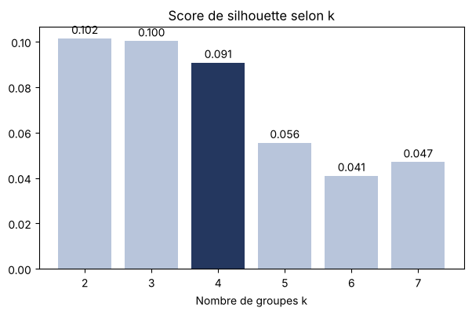
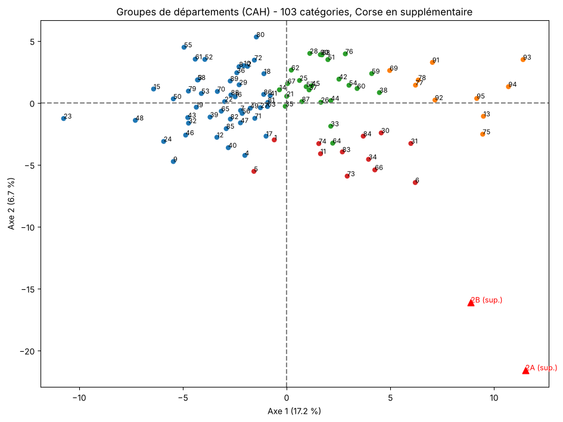
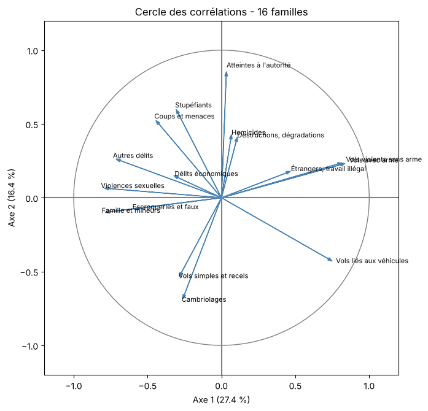
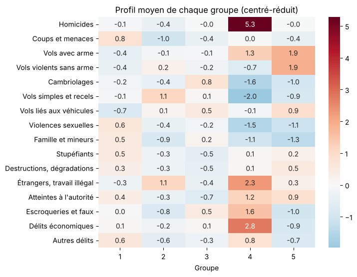
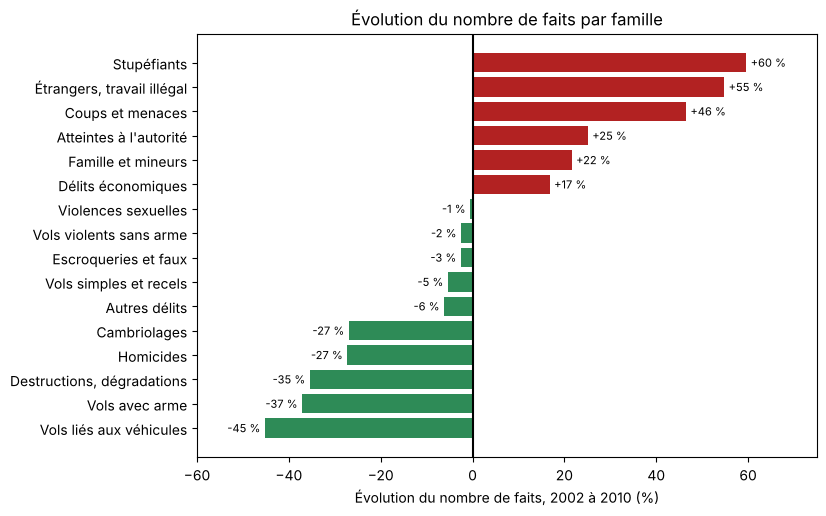

# Crime in France by département (2002–2010): PCA & clustering

Exploratory data analysis of recorded crime statistics for the 96 metropolitan French départements, using **Principal Component Analysis (PCA)**, **K-means** and **hierarchical clustering (Ward)**.

> Group project, Master 2 IDEAL (Decision Support / Data Science), Université de Lorraine, 2026.

## Questions

1. **Profiles (2010):** which départements have a similar crime profile across the 103 crime categories? Which ones are outliers?
2. **Best describing features:** are the 103 raw categories the right features? If not, what do the groups look like once the features are improved?
3. **Trends (2002 → 2010):** did crime change in volume and in nature, nationally and across different types of areas?

## Data

- 9 yearly files (`data/faits2002.csv` … `data/faits2010.csv`), provided as course material
- Each file: **103 crime categories × 96 départements** (Corsica is split into 2A and 2B)
- Data preparation:
  - read the files as `latin-1` with `;` separators
  - remove the thousands separators (`"1 146"` → `1146`) and convert the values to numbers
  - transpose the table so that départements become rows

## Method

| Step | What | Why |
|---|---|---|
| 1 | Convert raw counts to **profiles** (share of each crime type in a département's total) | On raw counts, PCA axis 1 only measured département size (correlation with total crime = **0.996**) |
| 2 | **K-means** on the 103 standardised profiles, choosing *k* with the silhouette score | First segmentation |
| 3 | **Standardised PCA**, interpreting the axes with variable and individual thresholds | To summarise 103 variables and understand why K-means struggled |
| 4 | Corsica as a **supplementary individual** | 2A + 2B contributed **72 %** of axis 2 |
| 5 | **Ward hierarchical clustering** on the first 5 PCA axes | To remove the noise carried by the last axes |
| 6 | **Feature engineering:** 103 categories → **16 crime families** | Many rare (noisy) categories and many highly correlated pairs |
| 7 | 2002–2010 analysis: national totals, area-level trends, 2002–2009 profiles projected onto the 2010 PCA | Volume and nature of change |

## Key results

**1. Raw categories give weak clusters.** K-means on the 103 categories gives a silhouette score of only about 0.09. It produces a 58-département "catch-all" group, and Corsica ends up in a group of its own.



**2. Main axis: urban vs rural.** The first axis opposes two profiles:
- the big cities (75, 93, 13, 69), with more violent theft, pickpocketing and theft with knives;
- rural départements (23, 48, 15), with more theft on farms and building sites and more offences against animals.



**3. Better features, clearer structure.** Grouping the 103 categories into 16 crime families improves the analysis a lot:
- the first factorial plane goes from **24 % to 44 %** of the variance;
- Kaiser's rule keeps **5 axes instead of 30**;
- Corsica's largest contribution to an axis drops from 50 % to 17 %.

A second axis now appears: violence and drugs against property crime. It gives 5 interpretable groups.




**4. Less crime, but a different kind of crime.** Recorded crime fell by **16.1 %** between 2002 and 2010, in every area. The mix of crimes changed:
- vehicle-related theft: **−45 %**
- drug offences: **+60 %**
- immigration and illegal-work offences: **+55 %**
- assault and threats: **+46 %**

All areas moved in the same direction and kept their relative positions.



## Limitations

- These are **recorded** offences, not all offences committed. For drugs and immigration, the numbers also depend on how many police checks were made.
- There is no population data, so the analysis cannot compute rates per 100,000 inhabitants.
- The cluster names are our interpretation of the results.
- The 2010 areas are used for every year from 2002 to 2010.

## Repository structure

```
├── crime_analysis_france.ipynb   # full analysis (comments in French)
├── data/                         # faits2002.csv … faits2010.csv
├── figures/                      # charts exported from the notebook
├── requirements.txt
└── README.md
```

## How to run

```bash
pip install -r requirements.txt
jupyter notebook crime_analysis_france.ipynb
```

**Tools:** Python, pandas, NumPy, scikit-learn (PCA, KMeans, silhouette), SciPy (Ward linkage), Matplotlib, Seaborn.
